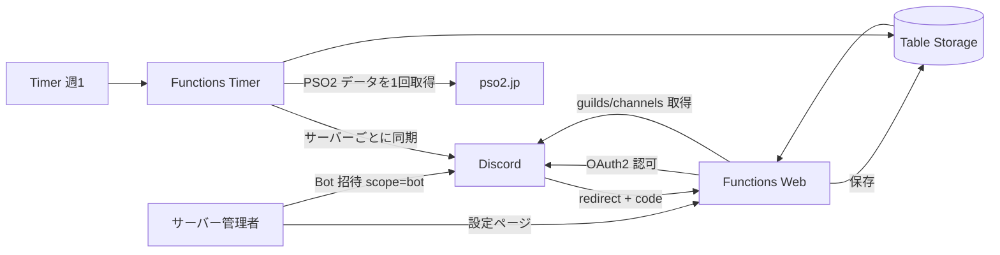

# 共有Bot設計（OAuth 設定フロー・Azure Functions）

複数サーバーに1つの Bot を配る場合の設計。サーバーごとの通知先は
**OAuth2 認可による Web 設定フロー**で行い、通知・イベント作成は
週1回の Timer だけで完結させる。

- 対象: このリポジトリの `pso2boost` を再利用する共有運用
- 前提: 各自が自分の Bot を動かすセルフホスト配布（テンプレート）はそのまま残す
- 経緯: 2026-11 までは HTTP Interactions（`/setup` スラッシュコマンド）を使っていたが、
  **Discord の「3秒以内の応答」制約がスケールゼロのサーバーレスと相性不良**だったため
  OAuth 方式へ移行した（詳細は §15）

## 1. 目的と非目的

### 目的

- 1つの Bot トークンで複数サーバーへ通知・イベント作成
- サーバーごとの通知先チャンネルを `/setup` で設定
- 週1回のバッチで新着・開始・終了を処理
- 運用費をほぼ0円に保つ

### 非目的（MVPではやらない）

- Web の設定画面・OAuth ログイン
- サーバーごとの細かいカスタマイズ（キーワード、時刻、複数チャンネル）
- リアルタイム通知（Gateway 常駐）
- スラッシュコマンド以外のインタラクション

## 2. 全体構成



- 設定フローは **ブラウザ経由の OAuth2**（ブラウザは待てるので応答時間の
  ハード制約が無い。旧方式の HTTP Interactions は3秒制約があった）
- 定期実行は **Timer trigger**（水曜 04:00 UTC = 13:00 JST）
- 状態は **Table Storage**（サーバーごとにパーティション）

## 3. Discord 側の設定

| 項目 | 値 |
| --- | --- |
| Bot 招待の Scopes | `bot`（権限はイベント作成・管理・投稿・閲覧） |
| 設定フローの Scopes | `identify guilds`（OAuth2 Redirect URI の登録が必要） |
| Redirect URI | `https://<function-app>.azurewebsites.net/api/setup/callback` |
| Bot 認証 | 100サーバー超で必要（申請） |

Bot 招待 URL:

```
https://discord.com/oauth2/authorize?client_id=<APP_ID>&scope=bot&permissions=17600775982080
```

スラッシュコマンドは使わない（旧 `/setup` は廃止。コマンド登録は不要）。

## 4. データモデル（Table Storage）

### `guilds`

| キー | 型 | 内容 |
| --- | --- | --- |
| PartitionKey | string | 固定 `"guild"` |
| RowKey | string | `guild_id` |
| channel_id | string | 通知先チャンネル |
| mention_role_id | string | 新着時のメンション（任意） |
| enabled | bool | 停止フラグ |
| permissions_ok | bool | 権限チェック結果 |
| added_at / last_run_at | datetime | 運用情報 |
| last_error | string | 直近のエラー（200文字程度） |

### `state`

| キー | 型 | 内容 |
| --- | --- | --- |
| PartitionKey | string | `guild_id` |
| RowKey | string | `event:<event_key>` |
| discord_event_id | string | Discord イベント ID |
| signature | string | 内容の変更検知用 |
| end | datetime | 終了時刻（掃除用） |
| new_sent / start_sent / end_sent | bool | 通知済みフラグ |
| updated_at | datetime | |

- パーティション = サーバーなので、1サーバー分の読み書きが1クエリで済む
- 終了から30日たった行は Timer で削除
- サーバー削除（Bot キック）は Timer で `GET /guilds/{id}` が 404/403 なら `enabled=false`

## 5. 処理フロー

### 設定フロー（OAuth2）

1. サーバー管理者が `https://<function-app>.azurewebsites.net/api/setup` を開く
2. Discord の認可画面（scope: `identify guilds`）で許可 → コールバックへ
   - CSRF 対策: `state` をランダム生成し、クッキーとクエリで照合
3. アクセストークンと **コードを1回だけ交換して使う**（保存しない →
   リフレッシュトークン管理は不要）
4. 「サーバーを管理」権限のあるサーバー一覧を表示して選択
   - 権限は OAuth の `guilds` レスポンスの `permissions` で判定
   - 選択可能なサーバーIDを **15分有効の HMAC 署名付きクッキー** に保存
     （サーバー側にセッション状態を持たない）
5. 選んだサーバーのテキストチャンネル一覧を **Bot トークン** で取得して表示
   - Bot が未参加のサーバーなら、そのサーバー指定つきの招待 URL を案内
6. チャンネルを選んで保存 → `guilds` テーブルへ upsert → 完了ページ

```
✅ 通知先を #テスト に設定しました
毎週水曜 13:00 (JST) にブーストキャンペーンの通知とイベント作成を行います。
```

### 週次 Timer

1. `guilds` から `enabled=true` を全件取得
2. PSO2 データを**1回だけ**取得（カレンダー → スケジュール → RSS → 記事）
3. イベント一覧を構築（既存 `pso2boost` のパーサを再利用）
4. サーバーごとに並列（同時 4〜8）で処理
   - `state` を読む
   - 新着 / 開始 / 終了 / 更新 / 削除 を判定
   - Discord イベントを作成・更新
   - チャンネルへ投稿
   - `state` を保存
5. サマリをログ出力（作成/更新/削除/失敗数）

同時実行は `asyncio.Semaphore` で制限。429 は `retry_after` に従って待つ。

## 6. 冪等性と失敗時

- **処理順**: Discord イベント作成 → 投稿 → フラグ保存
- 投稿に失敗したらフラグを立てない → 次回再試行（イベントは既にあるので作成はスキップ）
- イベントが Discord 側に無い（404）なら state を捨てて作り直す（実装済みの自己修復）
- 1サーバーの失敗で全体を止めない。`last_error` に記録して次へ
- Timer 全体がタイムアウトした場合も、保存済みのフラグまでは前進している

## 7. スケーリング

| サーバー数 | 目安 | 対応 |
| --- | --- | --- |
| 〜50 | 1〜2分 | そのまま |
| 〜200 | 3〜5分 | 並列度を上げる（5→8） |
| 200超 | 5分超過 | Durable Functions でシャード分割、または Timer を2本に分ける |

- Discord のレート制限は全体 50 req/s。1サーバーあたり数リクエストなので、
  並列 8 でも余裕がある
- PSO2 側の取得はサーバー数に依存させない（共有キャッシュ）

## 8. セキュリティ

- 設定フローは OAuth2 認可 + `state` 照合（CSRF 対策）＋ 15分有効の署名付きセッション
- 設定可能なのは `MANAGE_GUILD` を持つユーザーだけ（OAuth の permissions で判定）
- Bot トークン / クライアントシークレット / セッション鍵はアプリ設定（Key Vault は任意）
- 保存するのは `guild_id` / `channel_id` / イベント ID のみ。メッセージ内容やユーザー情報は保存しない
  （設定フローのユーザーアクセストークンもコールバックで1回使うだけで保存しない）
- Azure 側は Managed Identity + Storage の RBAC も選択可（MVP は接続文字列）

## 9. Azure リソースと費用

| リソース | 用途 | 月額 |
| --- | --- | --- |
| Function App（Consumption / Linux） | Timer + HTTP | 0円（無料枠） |
| Storage Account | Table + Functions ランタイム | 数円 |
| Application Insights | ログ（任意） | 0〜（取り込み量次第） |
| Key Vault | 秘密管理（任意） | 0円（操作課金のみ） |

週1回・数十サーバーなら **0〜10円/月**。100万実行 / 400,000 GB-s の無料枠に対して誤差。

## 10. デプロイ（GitHub Actions / OIDC）

Azure への配置も GitHub Actions で行う。認証は **OIDC**（公開プロファイル不要）。
`main` へ push すると自動デプロイ、手動実行も可能にする。

### Azure 側の準備（1回だけ）

1. ユーザー割り当てマネージド ID を作成
2. その ID に、関数アプリスコープで **Website Contributor** を付与
3. フェデレーション資格情報を作成（GitHub / 組織 / リポジトリ / ブランチ `main`）
   - **注意（2026-11 実測）**: GitHub Actions の OIDC トークンの `sub` は
     `repo:<owner>@<owner_id>/<repo>@<repo_id>:ref:refs/heads/main` 形式で提示される。
     ポータルの GitHub シナリオが雛形にする `repo:<owner>/<repo>:ref:refs/heads/main`
     （ID なし）では **AADSTS700213（No matching federated identity record）** になる。
     `az identity federated-credential create` の `--subject` に ID 入りの形式
     （例: `repo:denpadokei@55026301/pso2ngs-boost-bot@1462151752:ref:refs/heads/main`）
     を指定して作成すること。owner_id / repo_id はリネームで変わらないため安定。
4. リポジトリ変数（Secrets ではなく Variables）に登録

| 変数 | 値 |
| --- | --- |
| `AZURE_CLIENT_ID` | マネージド ID のクライアント ID |
| `AZURE_TENANT_ID` | テナント ID |
| `AZURE_SUBSCRIPTION_ID` | サブスクリプション ID |
| `AZURE_FUNCTIONAPP_NAME` | 関数アプリ名（未設定ならデプロイをスキップ） |

`AZURE_FUNCTIONAPP_NAME` を空にしておけば、ワークフローは失敗せずスキップする。
Azure 側の準備ができてから設定する。

### ワークフロー

```yaml
name: deploy-cloud

on:
  push:
    branches: [main]
    paths:
      - "function_app.py"
      - "host.json"
      - "cloud/**"
      - "pso2boost/**"
      - "cloud/requirements.txt"
      - ".github/workflows/deploy-cloud.yml"
  workflow_dispatch:

concurrency:
  group: deploy-cloud
  cancel-in-progress: false

permissions:
  id-token: write
  contents: read

jobs:
  deploy:
    if: vars.AZURE_FUNCTIONAPP_NAME != ''
    runs-on: ubuntu-latest
    steps:
      - uses: actions/checkout@v4

      - uses: actions/setup-python@v5
        with:
          python-version: "3.12"

      - name: Build package
        run: |
          mkdir -p build
          cp function_app.py host.json build/
          cp -r pso2boost cloud build/
          python -m pip install -r cloud/requirements.txt \
            --target build/.python_packages/lib/site-packages

      - uses: azure/login@v3
        with:
          client-id: ${{ vars.AZURE_CLIENT_ID }}
          tenant-id: ${{ vars.AZURE_TENANT_ID }}
          subscription-id: ${{ vars.AZURE_SUBSCRIPTION_ID }}

      - uses: Azure/functions-action@v1
        with:
          app-name: ${{ vars.AZURE_FUNCTIONAPP_NAME }}
          package: build
```

> ※上のスニペットは設計時のもの。実装した `.github/workflows/deploy-cloud.yml` は
> **リモートビルド方式**（プラン自動判別つき）に変更している。詳細は §16。

### 依存関係の入れ方

OIDC + パッケージデプロイでは remote build に頼らず、**依存を同梱**する。
`pip install --target build/.python_packages/lib/site-packages` は Linux の
Consumption プランでサポートされている配置方法。

- 自己ホスト用の `requirements.txt` は軽いまま（`azure-functions` を入れない）
- Functions 用は `cloud/requirements.txt` に分ける
- ローカルで `azure-functions` を入れたくない人に影響しない

### 運用

- デプロイ後の確認: `curl https://<app>.azurewebsites.net/api/health`（Phase 1 で追加）
- ロールバック: 直前のコミットを revert して再デプロイ（Consumption はスロット2つまで）
- 失敗時: Actions のログと `last_error` を見る。関数アプリ側は Application Insights 任意
- 本番承認を挟む場合は GitHub Environments を使う。その場合フェデレーション資格情報の
  subject を `environment:production` に合わせる

## 11. リポジトリ構成（追加分）

```
function_app.py          # Timer / HTTP の入口（薄く保つ）
host.json
cloud/
  __init__.py
  config.py              # 環境変数
  oauth.py               # OAuth2 認可・コード交換・署名セッション
  setup_pages.py         # 設定フローの HTML（start/callback/channels/save）
  discord.py             # Bot トークン用の最小 REST クライアント
  storage.py             # Table アクセス
  runner.py              # 週次バッチ
  requirements.txt       # Functions 用（azure-functions, azure-data-tables）
pso2boost/               # 既存（そのまま再利用）
.github/workflows/deploy-cloud.yml   # OIDC デプロイ
docs/shared-bot.md       # この設計書
```

### 既存コードの整理

- `cli.cmd_check` の判定ロジックを `service.plan_actions(events, state, now)` として抽出
- CLI とクラウドで同じ判定を使う（通知文言・リマインド条件の二重実装を避ける）
- `DiscordNotifier` は Bot 投稿に対応済み。`ScheduledEventsApi` もそのまま使える

## 12. 実装フェーズ

| Phase | 内容 | 完了条件 |
| --- | --- | --- |
| 0 | `plan_actions` 抽出・テスト | CLI の挙動が変わらず全テスト green |
| 1 | Azure 最小構成（Timer → 1サーバー）＋ `deploy-cloud.yml` | push でデプロイされ、テスト鯖でイベント作成と投稿 |
| 2 | `/setup` + Table + 複数サーバー | 2サーバーで別チャンネルに通知 |
| 3 | 権限チェック・レート制限・削除・監視 | 片方の失敗が他方に影響しない |
| 4 | `/status` `/disable`、メンションロール | 運用が回る |

## 13. テスト方針

- **単体**: `plan_actions`（新着/開始/終了/変更/削除）、署名検証（既知のテストベクタ）、`/setup` ハンドラ（Fake Table）
- **結合**: Timer を `--dry-run` 相当で実行し、1サーバー分のアクションを検証
- **手動**: `func start` + テスト鯖で `/setup` → Timer 手動実行

## 14. 決めたいこと

1. 通知先は**1サーバー1チャンネル固定**でよいか（MVP は固定）
2. `/setup role:` でメンションロールを設定できるようにするか（Phase 4）
3. セルフホスト配布（テンプレート）を今後も維持するか（推奨: 維持）
4. 100サーバー超の Bot 認証まで目指すか
5. 実行時刻は水曜 13:00 JST 固定でよいか

## 15. HTTP Interactions から OAuth への移行（2026-11 実測）

当初は「OAuth を使わない」設計（`/setup` スラッシュコマンド + HTTP Interactions）
だったが、実運用で **技術選定の誤り** が判明したため移行した。

- HTTP Interactions には Discord 側の **3秒以内の応答** というハード制約がある
- Flex 従量課金（スケールゼロ）では、リクエスト到着前の **インスタンス再確保の
  待ち時間**（Azure のリクエスト遥測に現れない）がしばしば3秒を超えた
- 実測: サーバー内処理は約0.6〜1秒、ウォーム時の往復は0.1秒前後。
  タイムアウト時も保存自体は成功していたが、「✅」が表示されない UX 問題が残った
- 毎分の self-ping でインスタンスを温存する workaround も可能だが、
  「サーバーレスをサーバーレスでなくする小細工」であり設計の崩れだった

**OAuth 方式ではこの制約が構造的に消える**: 設定はユーザーのブラウザで行われ、
ブラウザは数秒の待ち時間に寛容だから。セルフホスト配布（テンプレート）と
週次バッチ部分は一切変わらない。

- ユーザーアクセストークンはコールバックで1回だけ使う（保存しない）ため、
  当初懸念していた「トークン更新の管理」は実質不要になった
- 旧 `/setup` コマンド・interactions エンドポイント・keep-alive・コマンド登録は
  すべて廃止した

## 16. 実装メモ（2026-11 実装時の判断）

設計書と細部が異なる・補足が必要な点。

- **Timer の Cron**: Azure Functions（NCRONTAB）は秒を含む6フィールドのため、
  `0 4 * * 3` ではなく `0 0 4 * * 3`（毎週水曜 04:00 UTC = 13:00 JST）。
- **RSS の既読**: state テーブルの予約パーティション `_shared` に全サーバー共用で
  保存する。「pso2.jp への取得を1回に抑える」ため、サーバーごとの state には
  RSS の既読を置かない。
- **state の RowKey**: `event:<event_key>` と `rss:<URL>`。URL は `/` `?` `#` など
  RowKey に使えない文字を含むため percent-encode して保存する。
- **並列実行**: `requests` が同期 API のため `asyncio.Semaphore` ではなく
  `ThreadPoolExecutor(max_workers=CLOUD_CONCURRENCY, 既定4)`。PSO2 側の
  HTTP は準備フェーズをメインスレッドで直列に実行し、ワーカーは Discord API だけ。
- **Phase 1 のフォールバック**: guilds テーブルに登録がなければ環境変数
  `DISCORD_GUILD_ID` / `DISCORD_CHANNEL_ID` の1サーバーを対象にする
  （このサーバーの `last_error` はログのみ）。設定フローによる登録があればそちら優先。
- **キック検出**: `GET /guilds/{id}` が 404/403 のときだけ `enabled=false`。
  429/5xx/ネットワークエラーでは無効化しない。
- **デプロイ方式**: 依存の同梱（`pip install --target .python_packages`）ではなく
  **リモートビルド（Oryx）** を使う。Flex Consumption の Python は公式に
  「remote build を使え」とされており、従来の Consumption でもリモートビルドは
  推奨パスのため共通化した。zip 直下にはセルフホスト用と Functions 用を
  合わせた `requirements.txt` を置く。プラン種別（FlexConsumption / 従来）は
  ワークフロー内で `az appservice plan show` の sku.tier から自動判別し、
  `Azure/functions-action` に渡すビルドフラグを切り替える
  （Flex: `remote-build`、従来: `scm-do-build-during-deployment` ＋ `enable-oryx-build`）。
- **インスタンスサイズ**: Flex Consumption で選択する場合は 2048MB（既定）で十分。
  このワークロード（週1回・数分のバッチ + 低頻度の設定ページ）の実使用メモリは
  200MB 程度に収まる。
- **旧コールドスタート問題（解決済み・記録）**: 旧方式（HTTP Interactions）では
  インスタンス再確保の待ち時間が Discord の3秒制約を超えることがあった。
  `keep_alive` Timer の毎分 self-ping で workaround していたが、OAuth 移行で
  問題の根源ごと消えた（§15）。なお deferReply（type 5）も検討したが、
  ACK を出す前の遅延には効かないため採用しなかった。
- **フェデレーション資格情報の Subject**: GitHub の OIDC トークンは
  `repo:<owner>@<owner_id>/<repo>@<repo_id>:ref:refs/heads/<branch>` 形式の `sub` を
  提示する（2026-11 実測。ID なしの旧形式では AADSTS700213 になる）。
  §10 の注意書きを参照。
