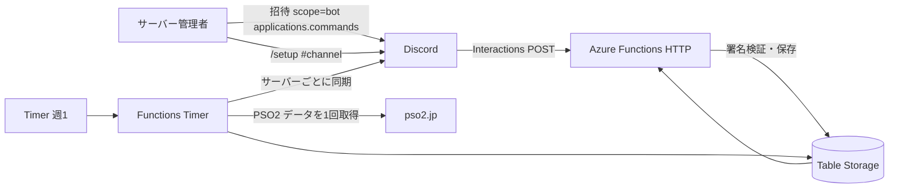

# 共有Bot設計（OAuth なし・Azure Functions）

複数サーバーに1つの Bot を配る場合の設計。**OAuth を使わず**、`/setup` スラッシュコマンドと
週1回の Timer だけで完結させる。

- 対象: このリポジトリの `pso2boost` を再利用する共有運用
- 前提: 各自が自分の Bot を動かすセルフホスト配布（テンプレート）はそのまま残す

## 1. 目的と非目的

### 目的

- 1つの Bot トークンで複数サーバーへ通知・イベント作成
- サーバーごとの通知先チャンネルを `/setup` で設定
- 週1回のバッチで新着・開始・終了を処理
- 運用費をほぼ0円に保つ

### 非目的（MVPではやらない）

- Web の設定画面・OAuth ログイン
- サーバーごとの細かいカスタマイズ（キーワード、時刻、複数チャンネル）
- リアルタイム通知（Gateway 常駐）
- スラッシュコマンド以外のインタラクション

## 2. 全体構成



- Discord → Functions は **HTTP Interactions**（Gateway 不要）
- 定期実行は **Timer trigger**（水曜 04:00 UTC = 13:00 JST）
- 状態は **Table Storage**（サーバーごとにパーティション）

## 3. Discord 側の設定

| 項目 | 値 |
| --- | --- |
| Scopes | `bot`, `applications.commands` |
| Permissions | イベントの作成 / イベントの管理 / メッセージを送信 / チャンネルを見る |
| Interactions Endpoint URL | `https://<function-app>.azurewebsites.net/api/interactions` |
| Bot 認証 | 100サーバー超で必要（申請） |

招待 URL:

```
https://discord.com/oauth2/authorize?client_id=<APP_ID>&scope=bot%20applications.commands&permissions=17600775982080
```

コマンドはグローバル登録（伝播に最大1時間）。開発中は `DISCORD_DEV_GUILD_ID` に
ギルドコマンドとして登録すると即時反映される。

### コマンド定義

| コマンド | オプション | 説明 |
| --- | --- | --- |
| `/setup` | `channel`（必須）, `role`（任意） | 通知先を登録・更新 |
| `/status` | なし | 現在の設定と次回実行を表示（Phase 4） |
| `/disable` | なし | 通知を停止（Phase 4） |

`default_member_permissions` に `MANAGE_GUILD` を設定し、サーバー側でも再確認する。

## 4. データモデル（Table Storage）

### `guilds`

| キー | 型 | 内容 |
| --- | --- | --- |
| PartitionKey | string | 固定 `"guild"` |
| RowKey | string | `guild_id` |
| channel_id | string | 通知先チャンネル |
| mention_role_id | string | 新着時のメンション（任意） |
| enabled | bool | 停止フラグ |
| permissions_ok | bool | 権限チェック結果 |
| added_at / last_run_at | datetime | 運用情報 |
| last_error | string | 直近のエラー（200文字程度） |

### `state`

| キー | 型 | 内容 |
| --- | --- | --- |
| PartitionKey | string | `guild_id` |
| RowKey | string | `event:<event_key>` |
| discord_event_id | string | Discord イベント ID |
| signature | string | 内容の変更検知用 |
| end | datetime | 終了時刻（掃除用） |
| new_sent / start_sent / end_sent | bool | 通知済みフラグ |
| updated_at | datetime | |

- パーティション = サーバーなので、1サーバー分の読み書きが1クエリで済む
- 終了から30日たった行は Timer で削除
- サーバー削除（Bot キック）は Timer で `GET /guilds/{id}` が 404/403 なら `enabled=false`

## 5. 処理フロー

### `/setup`

1. 署名検証（Ed25519、`X-Signature-Ed25519` / `X-Signature-Timestamp`）
2. `PING`（type 1）なら `{"type": 1}` を返す
3. `APPLICATION_COMMAND`（type 2）で `setup` 以外は無視
4. 実行者に `MANAGE_GUILD` があるか確認（なければ ephemeral で拒否）
5. チャンネルを `GET /channels/{id}` で検証（type 0/5）
6. Bot の権限を確認（不足なら警告を返しつつ保存はする）
7. `guilds` を upsert
8. 3秒以内に ephemeral 応答

```
✅ 通知先を #テスト に設定しました
次回実行: 2026-11-25 13:00 (JST)
```

### 週次 Timer

1. `guilds` から `enabled=true` を全件取得
2. PSO2 データを**1回だけ**取得（カレンダー → スケジュール → RSS → 記事）
3. イベント一覧を構築（既存 `pso2boost` のパーサを再利用）
4. サーバーごとに並列（同時 4〜8）で処理
   - `state` を読む
   - 新着 / 開始 / 終了 / 更新 / 削除 を判定
   - Discord イベントを作成・更新
   - チャンネルへ投稿
   - `state` を保存
5. サマリをログ出力（作成/更新/削除/失敗数）

同時実行は `asyncio.Semaphore` で制限。429 は `retry_after` に従って待つ。

## 6. 冪等性と失敗時

- **処理順**: Discord イベント作成 → 投稿 → フラグ保存
- 投稿に失敗したらフラグを立てない → 次回再試行（イベントは既にあるので作成はスキップ）
- イベントが Discord 側に無い（404）なら state を捨てて作り直す（実装済みの自己修復）
- 1サーバーの失敗で全体を止めない。`last_error` に記録して次へ
- Timer 全体がタイムアウトした場合も、保存済みのフラグまでは前進している

## 7. スケーリング

| サーバー数 | 目安 | 対応 |
| --- | --- | --- |
| 〜50 | 1〜2分 | そのまま |
| 〜200 | 3〜5分 | 並列度を上げる（5→8） |
| 200超 | 5分超過 | Durable Functions でシャード分割、または Timer を2本に分ける |

- Discord のレート制限は全体 50 req/s。1サーバーあたり数リクエストなので、
  並列 8 でも余裕がある
- PSO2 側の取得はサーバー数に依存させない（共有キャッシュ）

## 8. セキュリティ

- Interactions は毎回署名検証。失敗は 401
- コマンドは `MANAGE_GUILD` のみ
- Bot トークン / Public Key はアプリ設定（Key Vault は任意）
- 保存するのは `guild_id` / `channel_id` / イベント ID のみ。メッセージ内容やユーザー情報は保存しない
- Azure 側は Managed Identity + Storage の RBAC も選択可（MVP は接続文字列）

## 9. Azure リソースと費用

| リソース | 用途 | 月額 |
| --- | --- | --- |
| Function App（Consumption / Linux） | Timer + HTTP | 0円（無料枠） |
| Storage Account | Table + Functions ランタイム | 数円 |
| Application Insights | ログ（任意） | 0〜（取り込み量次第） |
| Key Vault | 秘密管理（任意） | 0円（操作課金のみ） |

週1回・数十サーバーなら **0〜10円/月**。100万実行 / 400,000 GB-s の無料枠に対して誤差。

## 10. デプロイ（GitHub Actions / OIDC）

Azure への配置も GitHub Actions で行う。認証は **OIDC**（公開プロファイル不要）。
`main` へ push すると自動デプロイ、手動実行も可能にする。

### Azure 側の準備（1回だけ）

1. ユーザー割り当てマネージド ID を作成
2. その ID に、関数アプリスコープで **Website Contributor** を付与
3. フェデレーション資格情報を作成（GitHub / 組織 / リポジトリ / ブランチ `main`）
4. リポジトリ変数（Secrets ではなく Variables）に登録

| 変数 | 値 |
| --- | --- |
| `AZURE_CLIENT_ID` | マネージド ID のクライアント ID |
| `AZURE_TENANT_ID` | テナント ID |
| `AZURE_SUBSCRIPTION_ID` | サブスクリプション ID |
| `AZURE_FUNCTIONAPP_NAME` | 関数アプリ名（未設定ならデプロイをスキップ） |

`AZURE_FUNCTIONAPP_NAME` を空にしておけば、ワークフローは失敗せずスキップする。
Azure 側の準備ができてから設定する。

### ワークフロー

```yaml
name: deploy-cloud

on:
  push:
    branches: [main]
    paths:
      - "function_app.py"
      - "host.json"
      - "cloud/**"
      - "pso2boost/**"
      - "cloud/requirements.txt"
      - ".github/workflows/deploy-cloud.yml"
  workflow_dispatch:

concurrency:
  group: deploy-cloud
  cancel-in-progress: false

permissions:
  id-token: write
  contents: read

jobs:
  deploy:
    if: vars.AZURE_FUNCTIONAPP_NAME != ''
    runs-on: ubuntu-latest
    steps:
      - uses: actions/checkout@v4

      - uses: actions/setup-python@v5
        with:
          python-version: "3.12"

      - name: Build package
        run: |
          mkdir -p build
          cp function_app.py host.json build/
          cp -r pso2boost cloud build/
          python -m pip install -r cloud/requirements.txt \
            --target build/.python_packages/lib/site-packages

      - uses: azure/login@v3
        with:
          client-id: ${{ vars.AZURE_CLIENT_ID }}
          tenant-id: ${{ vars.AZURE_TENANT_ID }}
          subscription-id: ${{ vars.AZURE_SUBSCRIPTION_ID }}

      - uses: Azure/functions-action@v1
        with:
          app-name: ${{ vars.AZURE_FUNCTIONAPP_NAME }}
          package: build
```

### 依存関係の入れ方

OIDC + パッケージデプロイでは remote build に頼らず、**依存を同梱**する。
`pip install --target build/.python_packages/lib/site-packages` は Linux の
Consumption プランでサポートされている配置方法。

- 自己ホスト用の `requirements.txt` は軽いまま（`azure-functions` を入れない）
- Functions 用は `cloud/requirements.txt` に分ける
- ローカルで `azure-functions` を入れたくない人に影響しない

### 運用

- デプロイ後の確認: `curl https://<app>.azurewebsites.net/api/health`（Phase 1 で追加）
- ロールバック: 直前のコミットを revert して再デプロイ（Consumption はスロット2つまで）
- 失敗時: Actions のログと `last_error` を見る。関数アプリ側は Application Insights 任意
- 本番承認を挟む場合は GitHub Environments を使う。その場合フェデレーション資格情報の
  subject を `environment:production` に合わせる

## 11. リポジトリ構成（追加分）

```
function_app.py          # Timer / HTTP の入口（薄く保つ）
host.json
cloud/
  __init__.py
  config.py              # 環境変数
  interactions.py        # 署名検証・/setup
  storage.py             # Table アクセス
  runner.py              # 週次バッチ
  commands.py            # コマンド登録スクリプト
  requirements.txt       # Functions 用（azure-functions, azure-data-tables）
pso2boost/               # 既存（そのまま再利用）
.github/workflows/deploy-cloud.yml   # OIDC デプロイ
docs/shared-bot.md       # この設計書
```

### 既存コードの整理

- `cli.cmd_check` の判定ロジックを `service.plan_actions(events, state, now)` として抽出
- CLI とクラウドで同じ判定を使う（通知文言・リマインド条件の二重実装を避ける）
- `DiscordNotifier` は Bot 投稿に対応済み。`ScheduledEventsApi` もそのまま使える

## 12. 実装フェーズ

| Phase | 内容 | 完了条件 |
| --- | --- | --- |
| 0 | `plan_actions` 抽出・テスト | CLI の挙動が変わらず全テスト green |
| 1 | Azure 最小構成（Timer → 1サーバー）＋ `deploy-cloud.yml` | push でデプロイされ、テスト鯖でイベント作成と投稿 |
| 2 | `/setup` + Table + 複数サーバー | 2サーバーで別チャンネルに通知 |
| 3 | 権限チェック・レート制限・削除・監視 | 片方の失敗が他方に影響しない |
| 4 | `/status` `/disable`、メンションロール | 運用が回る |

## 13. テスト方針

- **単体**: `plan_actions`（新着/開始/終了/変更/削除）、署名検証（既知のテストベクタ）、`/setup` ハンドラ（Fake Table）
- **結合**: Timer を `--dry-run` 相当で実行し、1サーバー分のアクションを検証
- **手動**: `func start` + テスト鯖で `/setup` → Timer 手動実行

## 14. 決めたいこと

1. 通知先は**1サーバー1チャンネル固定**でよいか（MVP は固定）
2. `/setup role:` でメンションロールを設定できるようにするか（Phase 4）
3. セルフホスト配布（テンプレート）を今後も維持するか（推奨: 維持）
4. 100サーバー超の Bot 認証まで目指すか
5. 実行時刻は水曜 13:00 JST 固定でよいか

## 15. OAuth を使わない理由

- 設定は `/setup` 1回で済み、Web UI が不要
- コールバック URL・セッション・CSRF 対策・トークン更新を持たなくてよい
- 権限は Discord 側のコマンド権限（`MANAGE_GUILD`）で制御できる
- どうしても Web 設定が必要になった段階で、後から OAuth を足せる
